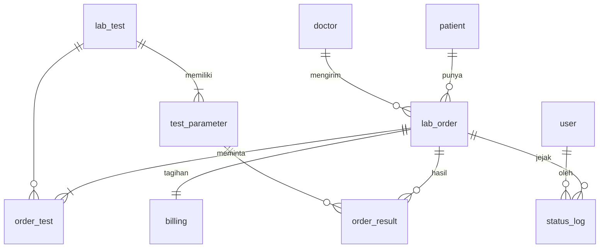

# SIMRS — Modul Laboratorium

Tugas EAS mata kuliah **Sistem Informasi Manajemen Rumah Sakit**.
Modul: **Laboratorium** · Kelompok: _Kelompok 8_ Kelas B
Anggota Kelompok:
1. Syalfa Azzahra Wahyudi (019)
2. Ziana Nawafila (021)
3. Kaila Nafisah Prisadira (025)
4. Charist Vincent Nathanael (028)
5. Najma Khoirun Nisa (034)

Aplikasi web untuk Instalasi Laboratorium yang mengikuti alur 6 langkah dari kuliah tamu:

| # | Langkah | Di aplikasi |
|---|---------|-------------|
| 1 | Order lab masuk dari dokter | **Order Baru** (pasien, dokter, pemeriksaan, cito/rutin) → nomor order, kode antrian `B-xx`, dan tagihan dibuat otomatis |
| 2 | Pasien dipanggil ke lab | Tombol **Panggil** pada halaman order |
| 3 | Cek identitas, ambil sampel | Form ambil sampel (wajib konfirmasi identitas, jenis sampel, waktu) |
| 4 | Label sampel dengan barcode | Barcode Code128 otomatis + **cetak label** |
| 5 | Periksa, input hasil per nilai | Form hasil: nilai rujukan per jenis kelamin, **flag H/L/HH/LL/A otomatis**, tombol *Ambil dari alat* (simulasi LIS) |
| 6 | Validasi, hasil terkirim ke dokter | Tombol **Validasi & kirim** → hasil terkunci, bisa **dicetak/PDF** |

Sesuai slide: petugas mengisi waktu & jenis sampel serta validasi; sistem otomatis mengisi nilai rujukan, flag, jenis pemeriksaan, dan **input billing (tarif pemeriksaan)**.

## Menjalankan

Butuh Python 3.9+.

```bash
git clone <url-repo-kelompok>
cd simrs-lab
python -m venv .venv
source .venv/bin/activate        # Windows: .venv\Scripts\activate
pip install -r requirements.txt
python run.py                    # buka http://127.0.0.1:5000
```

Database SQLite (`instance/simrs_lab.db`) dibuat otomatis beserta data contoh saat pertama dijalankan.
Reset data contoh: `flask --app run init-db`.


> **Catatan:** file database (`instance/*.db`) dan folder `__pycache__/` tidak disimpan di Git (lihat `.gitignore`).
> Setiap anggota membuat database sendiri di laptopnya, jadi jangan commit file `.db`.
> Perintah `init-db` **menghapus seluruh isi database** lalu mengisi ulang data contoh.

### Setelah menarik perubahan `.gitignore` (cukup sekali)

Kalau `git pull` gagal dengan pesan *"Your local changes ... would be overwritten"* pada `instance/simrs_lab.db`:

```bash
cp instance/simrs_lab.db ../backup_simrs.db   # opsional, kalau ada data yang mau disimpan
git restore instance/simrs_lab.db
git pull
python run.py                                 # database baru dibuat otomatis
```

**Akun demo**: `admin / admin123` · `analis / analis123` · `dokter / dokter123`

| Peran | Hak akses |
|-------|-----------|
| admin | semua fitur, master data, pembayaran |
| analis | panggil, ambil sampel, input hasil, validasi, order |
| dokter | buat/batalkan order, validasi hasil, lihat hasil |

## Pemetaan kriteria penilaian EAS

| Kriteria | Pemenuhan |
|----------|-----------|
| Front-End | Bootstrap 5 (lokal, tanpa CDN), layout sidebar, stepper alur 6 langkah, dashboard Chart.js, responsif, halaman cetak |
| Menu Pencarian | Pencarian global (pasien/No. RM/order/antrian/**scan barcode**), pencarian + filter di Order, Pasien, Pemeriksaan, Dokter, Billing, Laporan; autocomplete pasien di form order |
| Fungsionalitas | Alur 6 langkah dengan validasi urutan status, validasi input, kontrol peran, token CSRF, hasil terkunci setelah validasi |
| Integrasi Database | SQLite, 11 tabel berelasi (`schema.sql`), semua halaman membaca/menulis database, audit trail status |
| Kompleksitas & Kelengkapan | Nilai rujukan per jenis kelamin, nilai kritis, hasil kualitatif, billing & pembayaran, riwayat nilai pasien, dashboard & TAT, laporan + ekspor CSV, CRUD pasien/pemeriksaan/dokter |

## Struktur proyek

```
simrs-lab/
├── run.py                # titik masuk
├── schema.sql            # skema database
├── requirements.txt
├── app/
│   ├── __init__.py       # app factory, CSRF, filter template
│   ├── db.py             # koneksi SQLite
│   ├── services.py       # flag otomatis, penomoran, status
│   ├── seed.py           # data contoh (14 hari + antrian hari ini)
│   ├── routes/           # dashboard, orders, patients, master, billing, reports, auth
│   ├── templates/        # Jinja2 + Bootstrap
│   └── static/           # css, js, vendor (bootstrap, chart.js, jsbarcode)
└── tests/test_app.py     # tes alur 6 langkah
```

## Skema database (ERD ringkas)



## Tes

```bash
pip install pytest
python -m pytest -q
```

## Kolaborasi GitHub

Satu repository per kelompok. Tambahkan anggota di *Settings → Collaborators*, lalu bekerja dengan branch dan pull request.
Jangan membuka atau mengubah modul kelompok lain.

## Catatan

Nilai rujukan pada data contoh bersifat umum untuk keperluan pembelajaran, bukan acuan klinis.
